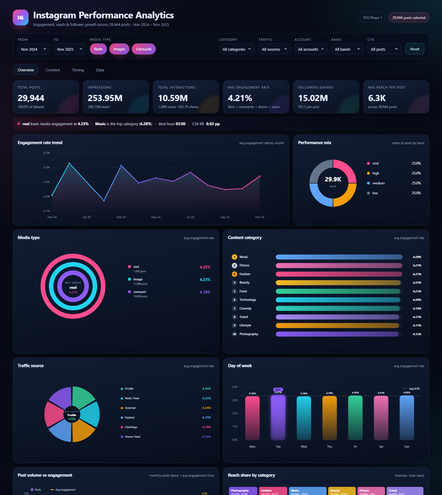

# Instagram Performance Analytics

Interactive analysis of 29,944 Instagram posts for FDS Phase 1.

**Authors:** Anamta Shafi (CT24011) and Syeda Amna Ali (CT24014)

The project contains two dashboards built on the same cleaned dataset:

- A **Power BI project** (`.pbip`) with a semantic model and a three-page report.
- A **self-contained web dashboard** with no build step and no external chart libraries.

## Project structure

```
fdssss/
├── dashboard.pbip                      # Open this in Power BI Desktop
├── dashboard.SemanticModel/            # TMDL model, Posts table, 17 measures
├── dashboard.Report/                   # PBIR report definition, 3 pages, custom theme
├── web/
│   ├── index.html                      # Web dashboard shell
│   ├── styles.css                      # Dark Instagram-inspired styling
│   ├── app.js                          # Filtering, SVG charts, tables, CSV export
│   ├── data.js                         # Encoded dataset for the browser (~2 MB)
│   └── build_data.py                   # Regenerates data.js from the CSV
├── Instagram_Analytics_cleaned.csv     # Cleaned source data (29,944 rows)
├── Instagram_Analytics_raw.csv         # Raw source data
├── Instagram_post_perfomance_analysis.ipynb
├── Final_Report.pdf
└── screenshots/
    └── web-overview.png                # Overview tab screenshot used below
```

## Quick start: web dashboard

Open `web/index.html` directly in a browser, or serve the folder:

```powershell
python -m http.server 8000
```

Then visit `http://localhost:8000/web/`.



### What you can do

- Filter by month range, media type, category, traffic source, account type, performance band, and CTA presence.
- Switch between **Overview**, **Content**, **Timing**, and **Data** tabs.
- Hover charts and heatmap cells for exact values.
- Click media/category/traffic dots or the performance-band donut to drill into a segment.
- Search the top-post table and download the currently filtered rows as CSV.

### Regenerate the browser dataset

If the CSV changes, run:

```powershell
python web/build_data.py
```

`data.js` stores compact row arrays with dictionary-encoded dimensions. The row layout is documented at the top of `web/app.js` and in `web/build_data.py`.

## Quick start: Power BI

1. Open `dashboard.pbip` in Power BI Desktop.
2. If prompted, enable the Power BI Project (PBIP) preview feature.
3. Refresh the model.

The model reads:

```
C:\Users\anamt\OneDrive\Desktop\fdssss\Instagram_Analytics_cleaned.csv
```

That path is absolute in `dashboard.SemanticModel/definition/model.tmdl`. If the project is moved to another folder or machine, update the `Source` path in the `Posts` M query and refresh.

### Report pages

| Page | Focus |
|---|---|
| **Overview** | KPI cards, monthly engagement trend, performance-band mix, media/category/traffic/day comparisons |
| **Content & Timing** | CTA comparison, best media/category, category scatter and table, media × band matrix, account mix, hourly engagement, best day/hour combinations, heatmap |
| **Performance Deep Dive** | Engagement by performance band, average reach by media, top posts, category scatter, filtered detail table |

The report uses the custom theme `InstagramInsights-7f3a9c2e.json` (dark background, Instagram pink/purple/cyan accents).

## Dataset

- **Rows:** 29,944
- **Date range:** 2024-11-19 to 2025-11-19
- **Columns:** `account_type`, `follower_count`, `media_type`, `content_category`, `traffic_source`, `has_call_to_action`, `post_datetime`, `post_date`, `post_hour`, `day_of_week`, `likes`, `comments`, `shares`, `saves`, `reach`, `impressions`, `engagement_rate`, `followers_gained`, `caption_length`, `hashtags_count`, `performance_bucket_label`

`performance_bucket_label` is provided in the cleaned data and splits posts into `low`, `medium`, `high`, and `viral` groups of roughly equal size. The groups overlap on raw engagement rate, so use the label as the supplied classification rather than a fixed threshold.

## Key findings

- **Scale:** 253.95M impressions, 188.13M reach, 10.59M interactions, and 15.02M followers gained.
- **Average engagement rate:** 4.21%, with 6.3K average reach per post.
- **Media types are close:** reels 4.23%, images 4.21%, carousels 4.18%. Format alone is not a major differentiator in this dataset.
- **Top categories:** Music (4.28%), Fitness (4.27%), and Fashion (4.27%). Photography is lowest at 4.15%.
- **CTA is not a lever here:** posts with a CTA average 4.19% versus 4.22% without one — effectively flat.
- **Account mix:** creators produce far more volume (20,905 posts) than brands (9,039), but both average 4.21% engagement.
- **Timing effects are small:** hourly averages stay roughly between 4.0% and 4.4%. The strongest day/hour combinations in the current data are around Tuesday 02:00 and Saturday 03:00, but the differences are modest.
- **Performance bands separate strongly:** viral posts average well above low-band posts, which is expected from the supplied band labels.

## Notes and limitations

- The dataset appears to be synthetic/academic; treat the findings as a demonstration of the analysis workflow, not as production social-media strategy.
- The web dashboard shows the top 150 posts in the table after filtering and search; the CSV export includes all filtered rows.
- The Power BI model uses an absolute CSV path. Refresh will fail if the file is moved without updating the M query.
- PBIR report/page/visual JSON was schema-validated during development. The report has not been opened in Power BI Desktop in this environment, so visual layout should be confirmed locally on first open.
- The web dashboard was tested in headless Chrome: all tabs, filters, reset, search, and chart rendering completed without console errors. The Overview screenshot above was captured from that run.
